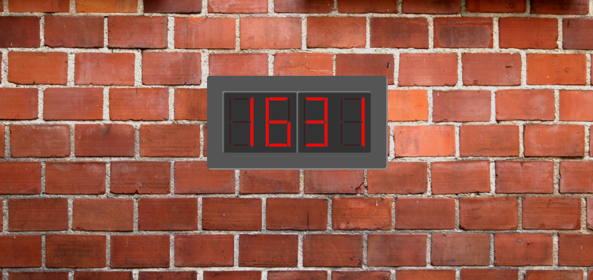

# Digital Clock

A simple digital clock application for displaying the current time.

This repository contains the source code for the Digital Clock project.

## Screenshot



## Features

- Digital time display
- Lightweight application
- Simple and minimal interface

## Source Code

The application source code is available in the [`src`](src/) directory.

## Getting Started

Clone the repository:

```bash
git clone https://github.com/StasX/digital-clock.git
cd digital-clock
```

See the `src` directory for the application files.

## License

This project is licensed under the Apache License 2.0. See the [LICENSE](LICENSE) file for details.

## Author

**Stanislav Mestechkin**

GitHub: [@StasX](https://github.com/StasX)